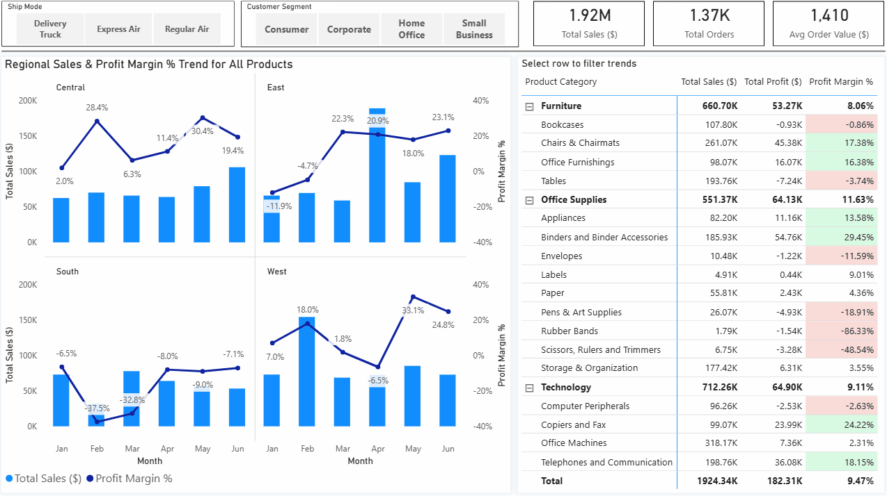
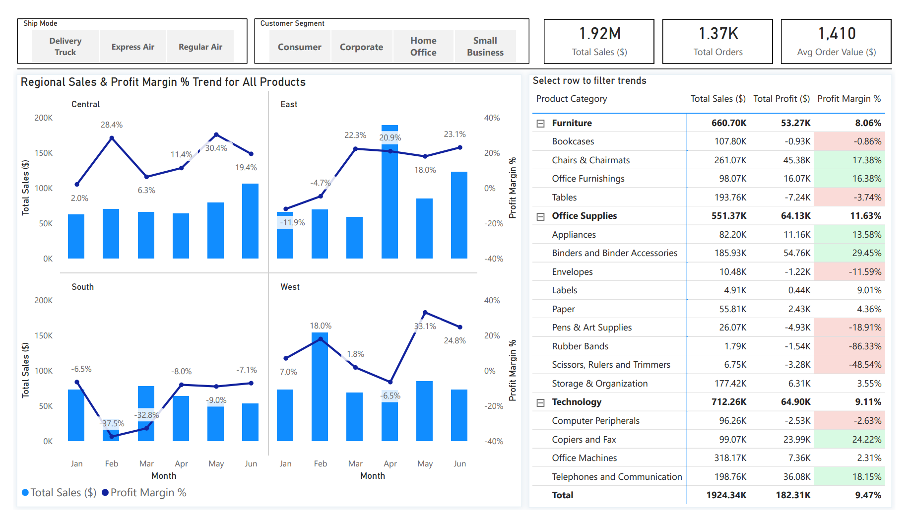
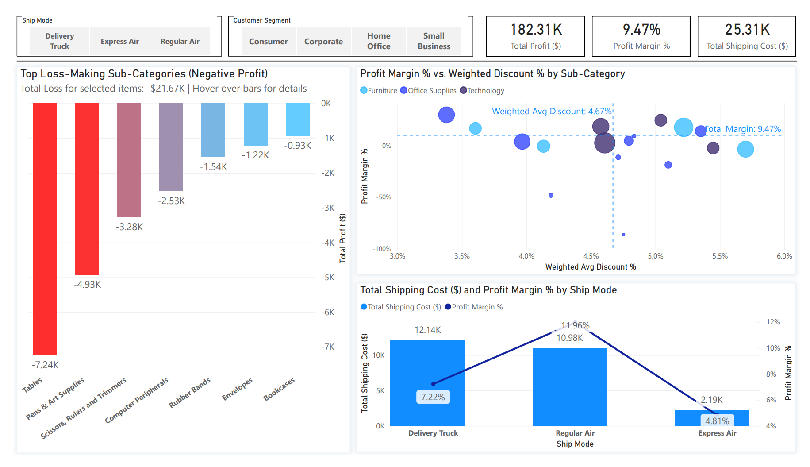

# Retail Commercial & Margin Optimization Analytics


A Power BI case study analyzing **1,370 orders** ($1.92M in gross revenue) across four sales regions. 

The goal of this project was to understand why healthy top-line sales weren't translating into bottom-line profit, audit discount efficiency, and fix logistics cost leaks.

---

## 🔗 Project Assets
- **Power BI File:** [Download .pbix](pbix/Retail_Margin_&_Pricing_Intelligence.pbix)
- **Executive Summary:** [Download PDF Report](Retail_Margin_Optimization_Executive_Summary.pdf)
- **Author LinkedIn:** [Szymon Khrapachenko](https://www.linkedin.com/in/szymon-khrapachenko)

---

## 📊 Dashboard Preview



### 1. Sales & Regional Overview
Tracks monthly revenue and profit margins across Central, East, South, and West territories, with cross-filtering by customer segment and shipping method.



### 2. Profitability & Cost Drivers
Evaluates discount elasticity and freight impact. Highlights chronic loss-making products and identifies the exact discount thresholds where margins turn negative.



---

## 💡 Key Business Findings

* **The $21.7K Profit Leak:** While overall revenue hit **$1.92M** with an average margin of **9.47%**, six sub-categories consistently lost money. The biggest issue was **Tables (-$7.24K operating loss)**, driven by high shipping costs and excessive discounting.
* **Corporate Margin Compression:** The Corporate segment delivered only a **2.62% margin** ($17.2K profit) despite generating massive sales volume, mainly due to unmonitored discounts averaging **5.06%**.
* **Air Freight on Heavy Items:** Shipping bulky items like Tables via **Regular Air** produced a **-40.61% margin**.
* **Free Truck Delivery on Bulky Goods:** Ground delivery via Delivery Truck yielded only **1.22% margin** for corporate orders because heavy items carried no freight surcharges.
* **The 4.5% Discount Limit:** Across all categories, volume-weighted discounts above **4.5%** wiped out profit margins without driving enough volume to compensate.

---

## 🛠️ Data Model & Architecture

The report is built on a clean, single-direction **Star Schema** to keep queries fast and memory usage minimal:

```text
                       +----------------------+
                       |    Dim_Customer      |
                       +----------+-----------+
                                  | 1:N
                                  v
+-----------------+ 1:N +--------------------+ 1:N +------------------+
|   Dim_Product   |---->|     Fact_Sales     |<----|  Dim_Geography   |
+-----------------+     +---------+----------+     +------------------+
                                  ^
                                  | 1:N
                        +---------+----------+
                        |      Dim_Date      |
                        +--------------------+

[ Security_User_Access ] (Disconnected table for Dynamic RLS evaluation)
```

---

### Modeling Standards

* **Zero Implicit Measures:** All numeric fields in Fact_Sales are hidden from report view to ensure users only interact with centralized, validated DAX measures.
* **Data Sanitization:** Handled raw data entry anomalies in Power Query (e.g., negative supplier costs that produced margins over 100%) to preserve financial accuracy.
* **Dynamic Row-Level Security (RLS):** Configured territory-level data filtering via an isolated security table, avoiding bidirectional relationship overhead.

---

## 💻 Core DAX Measures

### 1. Volume-Weighted Discount %

A simple AVERAGE() treats a 50% discount on a $5 item the same as a 2% discount on a $10,000 order. This measure weights discount rates by actual gross sales:

```dax
Weighted Avg Discount % = 
DIVIDE(
    SUMX(Fact_Sales, Fact_Sales[Discount] * Fact_Sales[Sales]),
    [Total Sales ($)],
    BLANK()
)
```
> [!NOTE]
> **Architectural Note on Scalability:**  
> On 2,000 rows, iterating with `SUMX` is instant. On 10M+ rows, doing row-by-row multiplication in DAX would bottleneck the single-threaded Formula Engine. In production, pre-calculating a physical `Discount_Amount` column in the DWH/ETL layer is preferred so DAX can use a simple `SUM()`.

### 2. Dynamic Loss-Making Subtitle

Calculates the total dollar loss for unprofitable products in the current filter context:

```dax
Loss Subtitle Dynamic = 
VAR _LossTable = 
    FILTER(
        VALUES(Dim_Product[Product Sub-Category]),
        [Total Profit ($)] < 0
    )
VAR _TotalLoss = SUMX(_LossTable, [Total Profit ($)])
RETURN
    IF(
        ISBLANK(_TotalLoss),
        "No loss-making items in current selection",
        "Total Loss for selected items: " & 
        FORMAT(DIVIDE(_TotalLoss, 1000), "$#,##0.00K") & 
        " | Hover over bars for details"
    )
```

### 3. Dynamic Regional RLS (Disconnected Pattern)

Filters the geographic dimension based on logged-in user credentials without creating complex relationships:

```dax
VAR _UserEmail = LOWER(USERPRINCIPALNAME())
VAR _UserRegions = 
    CALCULATETABLE(
        VALUES('Security_User_Access'[Region]),
        FILTER(
            ALL('Security_User_Access'),
            LOWER('Security_User_Access'[Email]) = _UserEmail
        )
    )
RETURN
    IF(
        "ALL" IN _UserRegions,
        TRUE(),
        'Dim_Geography'[Region] IN _UserRegions
    )
```

---

## 📁 Repository Structure

```text
├── pbix/
│   └── Retail_Margin_&_Pricing_Intelligence.pbix     # Production Power BI Workbook
├── screenshots/
│   ├── 01_sales_regional_overview.png                # Page 1 Visual Capture
│   ├── 02_profitability_cost_drivers.png             # Page 2 Visual Capture
│   └── demo.gif                                      # Interactive UI Preview
├── Retail_Margin_Optimization_Executive_Summary.pdf   # 5-Slide Boardroom PDF
└── README.md                                         # Project Documentation
```
